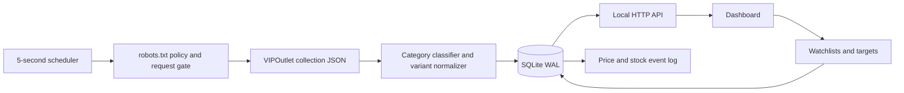

# ComponentWatch

**A hardware price monitor with a memory.** Track RAM, SSDs, and GPUs on VIPOutlet through a five-second collector, persistent price history, and a responsive dashboard.

Built with **Node.js 24, SQLite, JavaScript ES modules, HTML, and CSS**. Zero third-party runtime dependencies. No browser automation or credentials are needed to read the public feed.

## Run it

Install Node.js 24 or newer, open a terminal in this folder, and run:

```sh
npm start
```

Open **http://127.0.0.1:3000**. The default demo uses clearly labeled synthetic products and replayed prices, so it works offline. No `npm install` is necessary.

For **real VIPOutlet collection**, stop the demo with Ctrl+C, then:

```sh
npm run live
```

The first tick reads `robots.txt`. Product collection starts on the following eligible tick. Live mode starts with an empty database; history builds as prices or availability change. Demo and live databases are separate, so synthetic data never contaminates live observations.

The process must remain running for scans and alerts to continue. Closing the browser does not stop the Node collector; closing the server does. `npm start` starts a fresh process in the configured mode, not necessarily the mode of the previous run.

## Features

- Variant-level ingestion: a new and a refurbished version of a product have separate IDs, prices, and availability.
- RAM / SSD / GPU classification, with computer, memory-card, riser, adapter, and empty-enclosure exclusions.
- Durable SQLite inventory, change-only price history, and restock / sold-out events.
- Persistent watchlists and price targets, including alerts when an item becomes available below the target.
- Search, category and stock filters, sorting, interactive history charts, and CSV export.
- Scanner pause/resume, retry status, countdown, and observation timestamps.
- Same-origin local API, validated mutations, parameterized SQL, escaped product text, and CSV formula neutralization.
- Mocked failure tests, HTTP integration tests, GitHub Actions CI, and optional Docker deployment.

## What “every five seconds” means

`SCAN_INTERVAL_MS=5000` schedules **one queued collection page per tick**, at most one outbound request at a time. Pages contain up to 250 products. Two collection cursors rotate fairly: computer components and portable storage. If both collections fit on one page, each collection is normally revisited about every **10 seconds**. More pages, slow responses, a `Crawl-delay`, or backoff increase that interval.

This is not a promise to refresh every product on the site every five seconds. The UI also refreshes local state every five seconds. This distinction is useful to explain in an interview: scheduler cadence is different from complete inventory coverage and end-to-end detection latency.

The collector:

1. Refreshes `robots.txt` every six hours and honors matching rules and `Crawl-delay`.
2. Reads public Shopify collection JSON, filters relevant items, and normalizes each variant.
3. Uses `ETag` / `Last-Modified` validators when supplied. A `304` reuses the validated payload and updates freshness without duplicate history.
4. Writes a single transaction containing changed observations and target events.
5. Applies exponential backoff with jitter after errors; `Retry-After` is always a minimum wait.
6. Pauses on access denials or disallowed paths. It does not rotate proxies or bypass challenges.

A refresh is not evidence that scraping is universally authorized. Check the current [VIPOutlet robots file](https://vipoutlet.com/robots.txt) and [site terms](https://vipoutlet.com/pages/terms-conditions) before operating continuously. The implementation reevaluates access rules at runtime.

## Architecture



| Module | Responsibility |
| --- | --- |
| `src/collector.js` | Scheduling gate, single-flight collection, fair pagination, conditional requests, backoff |
| `src/robots.js` | Agent groups, longest-path rules, wildcards, anchors, crawl delay |
| `src/normalize.js` | Category classification, stable product/variant IDs, integer-cent prices |
| `src/store.js` | SQLite schema, transactional upserts, change history, edge-triggered alerts, retention |
| `src/server.js` | Local API, static dashboard, lifecycle and demo replay |
| `public/app.js` | Dashboard interactions, accessible controls, charts, export, static demo adapter |
| `public/demo-data.js` | Explicitly synthetic fixtures, shared by local and static demos |

SQLite runs in WAL mode. History is written only when price or availability changes, while `last_seen` is updated on each observation. A stable `product_id:variant_id` key prevents duplicate variants across collections. Prices use integer cents to avoid floating-point money errors. Price alerts are edge-triggered and rearm only after the qualifying condition stops being true.

## Configuration

Copy `.env.example` to `.env` if needed. Both Windows and macOS/Linux use the same npm commands.

| Variable | Default | Meaning |
| --- | --- | --- |
| `MODE` | `demo` | `demo` or `live`; `npm run live` explicitly overrides this |
| `SCAN_INTERVAL_MS` | `5000` | Scheduler period, minimum 5 seconds |
| `PORT` | `3000` | Local HTTP port |
| `HOST` | `127.0.0.1` | Listening interface; use loopback for local use |
| `USER_AGENT` | `ComponentWatch/1.0 (personal component price monitor)` | Descriptive collector identity; add your project/contact URL if available |
| `RETENTION_DAYS` | `90` | History/event retention; latest observation per variant is retained |
| `DB_PATH` | `data/<mode>.sqlite` | Optional SQLite path; keep demo and live paths separate |

The collected source lists are in `src/config.js`. Do not run multiple collector processes against the same database: rate limits are per process, and this project deliberately has a single-writer architecture.

## Test and verify

```sh
npm test
npm run build
npm run check:live
```

`npm test` is offline and uses in-memory databases and mock feed responses; the HTTP integration test binds an ephemeral loopback port. `check:live` is deliberately bounded: read robots.txt, wait the applicable delay, fetch one components page, print counts, and exit. It does not persist data or start continuous scraping.

The test suite covers money validation, accessory exclusions, variants, history deduplication, stock transitions, alert rearming, retention, robots matching, ETags/304 responses, request spacing, rate limits, blocked paths, schema drift, pagination, API input validation, foreign-origin protection, and path traversal rejection.

Node 24 may print an experimental warning for its built-in SQLite API. That is expected; no extra SQLite package is needed. Docker and the CI workflow are provided, but a successful local test run does not imply that either has been run in your account.

## Docker

```sh
docker compose up --build -d
```

The dashboard remains at `http://127.0.0.1:3000`. The named volume persists SQLite data. Set `MODE=live` in `.env` before starting to collect real data. Use `docker compose down` to stop. Keep the volume if you want to preserve your history.

The API is intended for a single user on localhost. Remote requests with a non-local Host header are rejected. Add authentication, authorization, and a deliberate ingress policy before exposing the live backend to the internet.

## Static portfolio demo

`npm run build` writes `dist/`, which can be served by a static host. In this version the dashboard replays synthetic data in the browser, watchlists persist in browser storage, and no collector runs on the hosting service. This makes a dependable presentation link while retaining the fully working collector in the source.

The initial Sites deployment is private to its owner. For recruiter access, publish the static build with your preferred hosting provider or explicitly change the demo's audience. Do not imply that the hosted demo contains live deals.

## API

| Method / route | Purpose |
| --- | --- |
| `GET /api/state` | Inventory, recent events, mode and scanner state |
| `GET /api/history?id=<variant-id>` | Last 500 retained changes for a variant, in chronological order |
| `GET /api/health` | Server health and scanner phase; server health does not imply upstream freshness |
| `POST /api/watch` | `{ "id": "product:variant", "watched": true, "target": 10000 }` (target in cents or null) |
| `POST /api/scanner` | `{ "action": "pause" }` or `{ "action": "resume" }` |

## Boundaries and next steps

Collection coverage is limited to the configured collections. If VIPOutlet changes its taxonomy or feed format, update the adapter. A disappearing product is not automatically marked sold out: absence can mean a moved listing or an incomplete page. The UI preserves the last observed status and timestamp. A pagination guard pauses after 100 full pages for manual review.

Targets generate in-app events, not email, SMS, or push notifications. The current chart displays retained changes, not a fixed-interval sampled series. A seller's compare-at price is not a historical price. The static demo resets its simulated market/history on reload while preserving watchlists.

Good extensions after you understand this implementation: typed feed schemas, more fixture-based classification tests, an authenticated multi-user API, queue-based delivery of notifications, and measured detection latency. See [docs/PORTFOLIO.md](docs/PORTFOLIO.md) for a demo script and defensible resume bullets.
